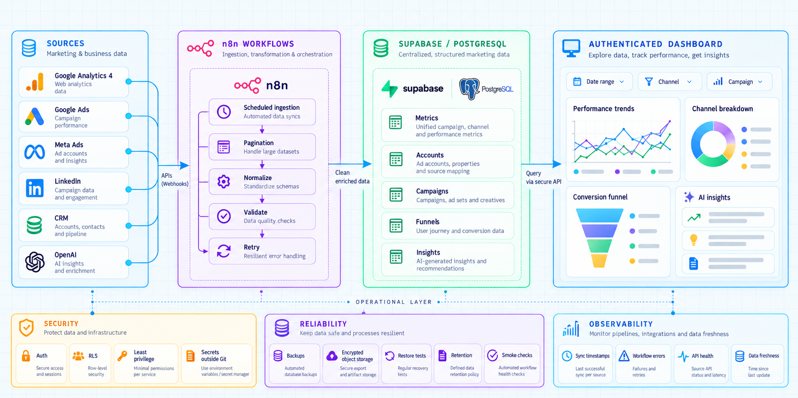
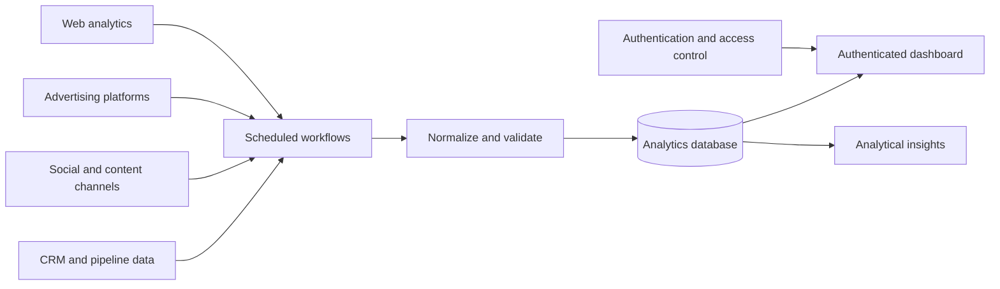

# Marketing Data Automation Platform

An anonymized portfolio implementation of a marketing data, automation, analytics, and dashboard platform.

This repository presents technical patterns for connecting multiple data sources, normalizing marketing and commercial signals, persisting analytical data, exposing authenticated views, and operating scheduled workflows. Customer names, account identifiers, production domains, private paths, credentials, certificates, exports, and the original Git history have been removed or generalized.

## What problem this solves

Marketing and commercial data is fragmented across analytics platforms, advertising networks, social channels, CRM systems, workflow engines, and AI services. This project establishes a common operational layer for scheduled collection, normalization, daily and item-level metrics, historical dashboards, analytical summaries, credential protection, and backup validation.

## Confirmed capabilities represented in the source

### Data ingestion and normalization

- Account and platform inventories
- Daily metrics and item-level metrics
- Campaign, content, and organic-publication measurements
- CRM pipeline, stage, and deal-history data
- Web analytics events and channel attribution fields
- Scheduled workflow execution and error tracking

### Dashboard and analytics

- Authenticated browser dashboard
- Period-based filtering and historical comparisons
- KPI cards, charts, tables, and empty-state handling
- Marketing funnel and commercial-stage views
- Social, advertising, analytics, CRM, and workflow sections
- AI-assisted insight presentation when generated data is available
- Sync-status and last-collection indicators

### Automation and integrations

The source documents integration patterns for analytics, advertising, social, CRM, database, AI, object-storage, and version-control services. The public copy keeps integration categories and data-flow concepts, but replaces client-specific accounts, IDs, schemas, domains, and credentials with placeholders.

### Operations and resilience

- Docker-based service configuration examples
- Nginx-compatible static dashboard delivery
- Scheduled data collection through workflow automation
- Backup-oriented operational conventions
- Encrypted external-backup design references
- Restore and smoke-test documentation patterns
- Explicit separation between versioned configuration and runtime secrets

## Architecture

Sanitized architecture notes are available under `docs/architecture/`.

## Technology areas

- Static HTML, CSS, and JavaScript dashboard
- Supabase-compatible authentication and database access patterns
- Workflow automation through n8n-style scheduled jobs
- PostgreSQL-compatible analytical persistence
- Docker and Docker Compose
- Nginx-compatible static delivery
- Cloud object-storage backup patterns
- External analytics, advertising, social, CRM, and AI integrations

The source copy does not claim production scale, uptime, conversion results, cost reduction, or performance benchmarks. Such claims require independent evidence and are intentionally not included.

## Security design

### Secret separation

- Runtime credentials belong in environment variables or protected runtime files.
- `.env`, password files, database password files, sync configuration, private keys, certificates, dumps, and dashboard runtime configuration are excluded.
- The public repository contains no real access tokens, API keys, cookies, connection strings, or user exports.
- Public examples use placeholders such as `YOUR_API_KEY`, `YOUR_PROJECT_ID`, `YOUR_DATABASE_URL`, and `example.invalid`.

### Access control

- Dashboard authentication is treated separately from data ingestion and workflow credentials.
- External integrations should use least-privilege credentials created by the operator.
- Tenant, account, organization, pipeline, and project identifiers are configuration concerns, not hard-coded public facts.
- Row-level or schema-level access policies should be reviewed before deploying an adapted version.

### Data minimization

- No real campaign records, leads, contacts, messages, account names, organization IDs, or CRM deals are included.
- Client-specific schemas and table names were generalized.
- Production paths, hostnames, domains, and operational inventories were removed.
- The original `.git` directory and all source history were excluded.

## Observability and operations

The operational model represented by the source includes collection timestamps, last-success indicators, workflow execution and error visibility, sync-state feedback, scheduled collection and retention conventions, backup status, restore-validation procedures, smoke checks, and explicit separation of configuration, code, and runtime data.

These are implementation and documentation patterns. They are not a claim that the public copy is connected to a live customer environment.

## Local review

Before adapting this portfolio copy to a private environment:

1. Create local credentials with least privilege.
2. Replace placeholders in ignored runtime configuration.
3. Create a development project and synthetic records.
4. Review database policies and dashboard query scopes.
5. Validate workflow retries, pagination, rate limits, and API error handling.
6. Test backup, restore, and secret-rotation procedures.
7. Run `git diff --check` before committing.

## Removed or generalized

- Customer and company identity
- Brand assets and logos
- Real domains, paths, organization identifiers, and account IDs
- Production schemas, CRM entities, and source-specific records
- Certificates and deployment-only infrastructure
- Backup scripts and operational exports coupled to the private environment
- Inventory documents containing real dates, sizes, or infrastructure state
- Original Git history

## Limitations

- No production database or real integration credentials are included.
- The dashboard requires a compatible local runtime configuration.
- External APIs require separate test accounts and credentials.
- Workflow execution, rate limits, and pagination must be validated in the adapted environment.
- The public copy is intended for technical review and portfolio presentation, not direct production deployment.

## License

Add the license that matches your intended portfolio distribution before publication.
